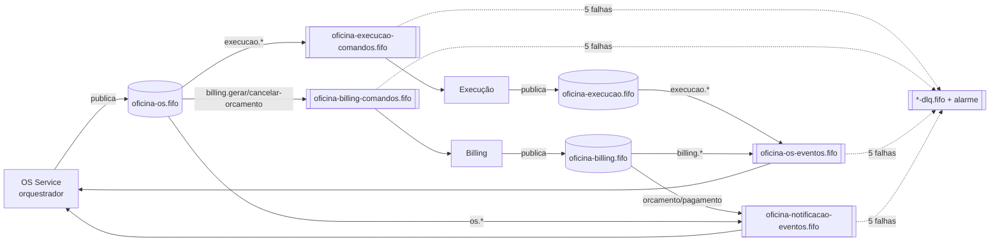

# Stage messaging — SNS + SQS FIFO (US-F4-02)

Mensageria assíncrona entre os microsserviços da Fase 4 ([RFC-0006](https://github.com/guilhermeqmaia/soat-fiap-oficina-os-service/blob/main/docs/arquitetura/rfcs/RFC-0006-mensageria.md)): **um tópico SNS FIFO por produtor**, **uma fila SQS FIFO por consumidor** com DLQ, assinaturas filtradas por `type` (atributo do envelope — [ADR-0009](https://github.com/guilhermeqmaia/soat-fiap-oficina-os-service/blob/main/docs/arquitetura/adr/ADR-0009-outbox-e-consumidor-idempotente.md)). Mesma topologia do LocalStack do kit (`scripts/messaging-local.sh`).



## Recursos

| Recurso | Nome | Notas |
|---|---|---|
| Tópicos SNS FIFO | `oficina-os.fifo`, `oficina-execucao.fifo`, `oficina-billing.fifo` | `MessageGroupId` = nº da OS, `MessageDeduplicationId` = id do envelope |
| Filas SQS FIFO | `oficina-execucao-comandos`, `oficina-billing-comandos`, `oficina-os-eventos`, `oficina-notificacao-eventos` (`.fifo`) | long polling 20 s, visibilidade 30 s, retenção 4 dias |
| DLQs | `<fila>-dlq.fifo` | `maxReceiveCount` 5, retenção 14 dias |
| Assinaturas | 6, `raw_message_delivery`, `filter_policy` por `type` | tabela em `locals.tf` (= AsyncAPI do hub) |
| IAM | policy `oficina-mecanica-messaging-services` | anexada à role dos nodes (`node_role_name`) — sem IRSA os pods herdam a role |
| Alarmes | `<fila>-dlq-nao-vazia` (CloudWatch) | e-mail opcional (`alert_email`); Datadog lê via integração AWS |
| SSM | `/oficina/messaging/topics/<p>/arn`, `/oficina/messaging/queues/<c>/url`, `.../dlq_url` | contrato lido pelo `scripts/messaging-vars.sh` |

## Como aplicar

```bash
cd messaging && terraform init -backend-config=../backend.hcl   # ou via CD: stage=messaging
terraform apply -var node_role_name=oficina-mecanica-eks-node-role
# propagar o contrato para os repos dos serviços (vars SNS_TOPIC_ARN / SQS_QUEUE_URL):
../scripts/messaging-vars.sh
```

Independente do cluster (só IAM depende da role dos nodes — opcional). Custo: free tier (1 M req SQS/mês, 1 M publicações SNS).

## Reprocessar a DLQ (runbook do alarme)

1. Inspecionar: `aws sqs receive-message --queue-url <dlq_url> --max-number-of-messages 10 --attribute-names All`
2. Corrigir a causa (bug no handler, dependência fora) — **nunca purgar sem triagem** (ADR-0009).
3. Devolver à fila principal: `aws sqs start-message-move-task --source-arn <dlq_arn> --destination-arn <fila_arn>` (o consumidor deduplica pelo `id`; mensagens já processadas são ignoradas).

## Qualidade

`terraform fmt -check && terraform validate` no CI; `plan` comentado no PR. Validado com `plan` real na conta própria (41 recursos).
